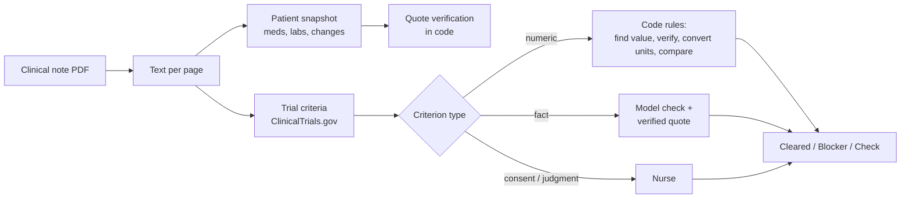

# Clinical RAG: Patient Snapshot and Trial Pre-Screening


 
Turns an ICU clinical note (PDF) into a **verified patient snapshot** for nurses and **pre-screens the patient against clinical trial eligibility criteria**. Every fact is cited to the exact page and quote it came from, and anything the tool can't prove is handed back to a human as UNKNOWN.
 
> **Not medical advice.** Built and tested only on synthetic clinical notes. Do not use with real patient data.
 
## Why I built this
 
While traveling in Bali, I got talking with two nurses from Australia. When I asked what the hardest part of their job was, I expected to hear about long shifts or difficult patients. Instead, they talked about paperwork. Every time they took over a patient, they had to dig through pages of clinical notes to find the few things that mattered right then: what medications had actually been given, what the latest labs showed, and what the plan was.
 
That stuck with me. I work with data and machine learning every day, and this felt like a problem I could actually do something about.
 
The project started as a question-answering tool over the note. Getting an answer was easy; getting a *correct* one was hard. Early versions listed a medication as given when the note only said it was being considered, which is exactly the kind of mistake that matters in a hospital. So the project evolved around one principle.
 
## The principle: the LLM reads, code decides
 
Language models are good at reading messy text and bad at being reliably right about numbers, units, and rules. So the work is split:
 
| The LLM does | Code does |
|---|---|
| Finds facts in the note and copies the exact quote | Checks every quote actually exists on the cited page |
| Turns a trial criterion into a structured rule ("platelets < 50,000/mm³") | Converts units and makes every numeric comparison |
| Copies values exactly as written | Combines rules with three-valued logic (TRUE / FALSE / UNKNOWN) |
| | Returns UNKNOWN for time windows, missing values, unit mismatches, or conflicting values |
 
**The tool never says a patient is "eligible."** It clears what the note proves, flags real blockers, and lists everything else for the nurse to check.
 
## How it works
 

 
**Patient snapshot** (`screening/snapshot.py`)
- One structured extraction call per section (medications, labs, medication changes), validated with Pydantic.
- A second pass looks specifically for medications the first pass missed.
- Lab labels (abnormal, not abnormal) come only from the note's own words verified on the cited page, otherwise from a target-range check in code. The model is not allowed to invent a label.
**Trial pre-screening** (`screening/matcher.py`, `screening/rules.py`)
- Code rules run first: anything with a time window ("within 12 hours") goes to UNKNOWN, since a single note can't confirm timing.
- Numeric criteria: the model parses the rule and copies values from the note; code verifies the number is inside the quote, converts units, and decides.
- Fact criteria: a model check that must come with a verified quote, otherwise downgraded to UNKNOWN.
## Results
 
All results are on a synthetic ICU note (septic shock from pneumonia, ARDS, AKI), measured against hand-labeled answer keys.
 
**Patient snapshot** (stable across 3 runs)
 
| Group | Recall |
|---|---|
| Active medications | 8/8 |
| Labs (abnormal / not abnormal / not labeled) | 23/23 (11/11, 3/3, 9/9) |
| Medications held, stopped, or considered | 3/3 |
| Items wrongly grouped | 0 |
| Quotes that failed verification | 2–3 of 56 (flagged, not trusted) |
 
**Trial pre-screening** (38 hand-labeled criteria, 2 trials from a frozen ClinicalTrials.gov snapshot)
 
| Metric | First version | Current |
|---|---|---|
| Accuracy | 64% | 79% |
| **False clears** (tool says criterion is met when it isn't; the safety metric) | 1 | **0** |
| False blocks | 1 | 0 |
| Missed info (UNKNOWN when the note had the answer) | 8 | 8 |
 
The first version wrongly cleared a "within 72 hours of intubation" criterion and wrongly blocked a patient for "chronic respiratory disease" because of acute ARDS. Moving time windows into code rules and teaching the fact check to separate chronic from acute conditions fixed both.
 
### Held-out notes (not used while building)

To check that results aren't tuned to one note, the snapshot is run on notes it was not developed on, with answer keys written **before** running the tool. `python -m evals.run_heldout --repeats 3` runs every note 3 times and reports the range.

| Note | Source | Independent? |
|---|---|---|
| Discharge summary, 75M, takotsubo | [Asclepius](https://huggingface.co/datasets/starmpcc/Asclepius-Synthetic-Clinical-Notes) | Yes |
| ICU follow-up, 68M, GI bleed + COPD | [MTSamples](https://www.kaggle.com/datasets/tboyle10/medicaltranscriptions) | Yes |
| Discharge summary, respiratory failure | MTSamples | Yes |
| ICU progress note, 61F, GI bleed (SI units, abbreviations) | Self-written | No |

**Results across 3 runs (4 notes):**

| Group | Worst to best | Conflicts |
|---|---|---|
| Given medications | 22/22 every run | 0 |
| Not-given medications (stopped, held, considered, planned) | 13 to 14 of 15 | 0 |
| Labs, all groups | 48/50 every run | 0 |

The misses: "avoid NSAIDs" is not always listed; one antibiotic course ("treated successfully with Levaquin", not in the discharge list) is ambiguous in the note and came back as active in 2 of 3 runs (flagged in the third); two lab interpretations written in the plan section, far from the value, come back as "not labeled" rather than with a wrong label. No run produced a conflict.

**What held-out testing changed in the design:**
- **Contradictions were hidden.** The first run listed heparin as both *active* and *discontinued*; the old eval counted it as correct. The eval now counts conflicts.
- **Medication status is now decided in code.** Run to run, the model gave different statuses for the same words ("we will add guaifenesin" came back as *active* once). Now the model only finds each medication and its quote; code reads the words around that medication and sets the status ("discontinued", "held", "consider", "will add", "discharged with"...). The same words give the same status every run. When the words are unclear, the model's status is kept and flagged for the nurse.

**Testing and cost:** 77 unit tests cover the rule engine and medication-status rules and run on every push (`python -m pytest`). A snapshot costs about $0.003 to $0.012 and 25 to 45 seconds per note (gpt-4o-mini); every run saves its cost, token count, timing, and git commit.

### Earlier stage: question answering over the note
 
| Version | Change | LLM-judge score |
|---|---|---|
| Baseline | 2 chunks retrieved per question | 7/10 |
| Improved | 6 chunks + clinical QA prompt | 9/10 |
 
Debugging showed retrieval was finding the right passages but generation still dropped items in long lists, which is why the snapshot now uses targeted per-section extraction instead of RAG.
 
## Known limitations
 
- **4 held-out notes, and they have now informed fixes.** Fresh notes that are never used for fixing are needed for a final, fully held-out score. Real ICU notes (MIMIC, with a local model) are next.
- **Ratio criteria** (e.g., weight per cm of height) return UNKNOWN; derived values aren't computed yet.
- **Time windows always return UNKNOWN** by design; a single note can't confirm timing.
- **No OCR.** Scanned PDFs without a text layer are rejected.
- **Home medications have no category of their own**; they are flagged rather than guessed.
- **Lab interpretations written far from the value** (for example in the plan section) are not linked to the value.
## Run it
 
Requires Python 3.10+ and an OpenAI API key. Use synthetic notes only.
 
```bash
git clone https://github.com/ManvishK7122/clinical-rag.git
cd clinical-rag
python -m venv venv
source venv/bin/activate        # Windows: venv\Scripts\activate
pip install -r requirements.txt
cp .env.example .env            # then add your OpenAI API key
```
 
Put a synthetic clinical note PDF in `data/` named `Sample_ICU_note.pdf`, then:
 
```bash
# Patient snapshot, then score it against the answer key
python -m screening.snapshot
python -m evals.eval_snapshot
 
# Save a frozen set of trials from ClinicalTrials.gov
python -m screening.trials --save septic_icu "septic shock" "ARDS" "acute kidney injury"
 
# Pre-screen the patient against specific trials, then score it
python -m screening.matcher --trials septic_icu --only NCT06849570 NCT07383103
python -m evals.eval_matcher outputs/match_septic_icu_Sample_ICU_note.json evals/criteria_key_septic_icu.json
 
# Label more criteria by hand (t / f / u)
python -m evals.label_criteria NCT06849570
```

Unit tests (no API calls) and the held-out evaluation:

```bash
python -m pytest -q
python -m evals.run_heldout --repeats 3
```
 
## Project structure
 
| Path | Purpose |
|---|---|
| `screening/snapshot.py` | Patient snapshot extraction, quote verification, lab labeling |
| `screening/rules.py` | Numeric rules in code: parsing, value finding, unit conversion, three-valued logic |
| `screening/matcher.py` | Trial pre-screening: code rules first, then numeric or fact checks |
| `screening/trials.py` | Fetches and freezes trials from ClinicalTrials.gov |
| `evals/` | Answer keys, labeling tool, and evaluation scripts |
| `evals/heldout/` | Held-out notes, answer keys written before running, labeling rules, sources and licenses |
| `tests/` | Unit tests for the rule engine and medication-status rules (run in CI on every push) |
| `CLAUDE.md` | Project rules for AI coding assistants (safety rules, definition of done) |
| `query.py`, `eval.py`, `prompts.py` | Earlier question-answering stage and its evaluation |
 
## Next steps
 
- More independent held-out notes (MTSamples; MIMIC with a local model)
- Baseline comparison: LLM decides everything vs. LLM reads, code decides
- FastAPI service and a simple web page: upload a note, get the snapshot and pre-screen
- A timed test with a clinician: minutes by hand vs. with the tool
## Stack
 
Python, OpenAI API, Pydantic, pypdf, ClinicalTrials.gov API, LlamaIndex (earlier stage)